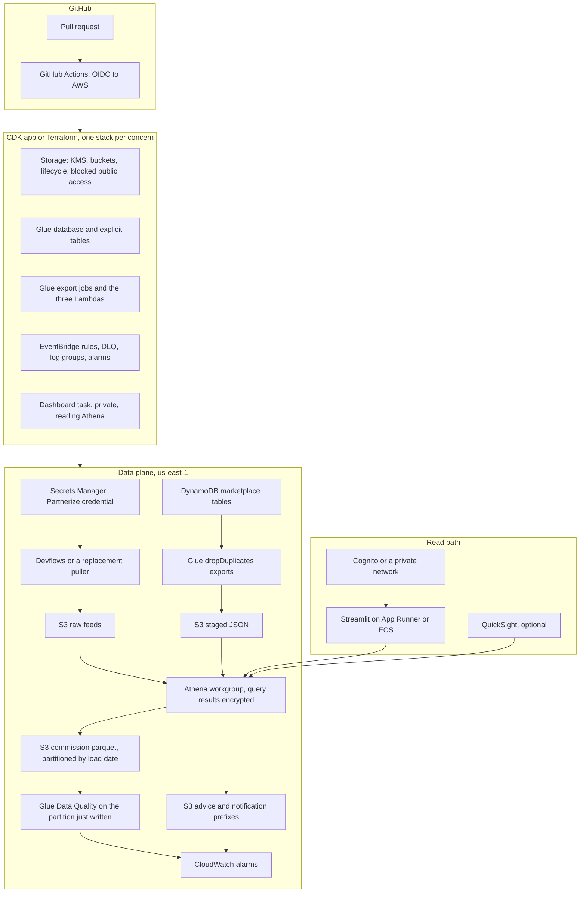

# Productionizing the partner-feeds pipeline

The local desk proves the joins, the windows, and the three output shapes. It is not a deployment. The Glue and Lambda files still have redacted catalog names, the commission job can insert the same row twice, two of the three Lambdas never check whether Athena finished, and the telco query builds SQL with an f-string. This note is the sequence that turns the working local run into something you can schedule in us-east-1.

Do the items in order. Each one leaves the pipeline runnable.

---

## Target architecture



Devflows can stay as the HTTP puller. The queue it already writes should have a dead-letter queue and an alarm on depth. Replacing Devflows is a separate project; do not block the lake work on it.

---

## 1. Get the names out of the source files

`glue-scripts/` and `lambda-functions/` store the database, table, and bucket as long `xxxx` placeholders, except `telco-notification.py`, which hardcodes the database `devflows_partner_feeds_pipeline`. `athena-queries/queries.sql` names the real objects the SQL was written against:

* database `devflows_partner_feeds_pipeline`
* feed tables `devflows_json_outputs` and `apple_devflows_json_outputs` (the UNLOAD and the Lambda do not use the same feed table; pick one and delete the other)
* `activationlink_refreshed`, `offer_refreshed`, `config_refreshed`, `campaign_refreshed`
* `common_commission_table`
* unload location `s3://totogi-marketplace-partner-feeds/common-commission-table/`

Move those to a config file per environment (SSM Parameter Store or a CDK context / Terraform tfvars). The Lambda reads them at cold start. Do not commit bucket names that were redacted on purpose, and do not commit the Partnerize credential at all. That credential belongs in Secrets Manager, read by whatever runs the HTTP pull.

While you are there, quote every identifier the same way. The payment-advice Lambda selects from `"dxxxx"."xxxx"` and filters `loadtime`. The commission insert aliases the column `LoadTime`. Athena folds unquoted names; the local lake uses `load_time` so the desk does not depend on that. Pick one spelling in the catalog and use it in all three statements.

---

## 2. Make a rerun overwrite a day instead of inserting it again

`common-commission.py` inserts every conversion whose upload time is inside the last 24 days. The next morning those same rows are still inside the window, and the insert writes them again. The local emulator avoids this by replacing `curated/common-commission/commission.parquet` on every run. That is safe for a sample and wrong for a growing table.

Partition the commission table by the upload date (`load_time` truncated to a day). Each run writes only the partitions that overlap the window, to a temporary prefix, then replaces those partitions. Athena `INSERT` is the wrong tool for that. A Glue job or a CTAS into the partition path is the right one. Keep the 24-day lookback so a late file can still repair the last three weeks, but a repair must delete the partition first.

Payment advice and the telco files are already dated prefixes (`daily-advice-for-{date}`, `daily-notification-for-{date}`). Overwrite those keys. They are derived, not a system of record.

Add `conversion_id` plus `conversion_item_id` to the commission grain. The SQL today has `item_value` and no item id, so two items with the same value are indistinguishable. The sample feed already carries `conversion_item_id`. Bring it through the select list before you build a primary key.

---

## 3. Wait for Athena, and fail the invocation when it fails

`common-commission.py` and `payment-advice.py` call `start_query_execution` and return. A failed query is still a successful Lambda. `telco-notification.py` sleeps two seconds and then calls `get_query_results`, which is not long enough for a real scan and will throw or return partial results under load.

Poll `get_query_execution` with backoff until the state is `SUCCEEDED`, `FAILED`, or `CANCELLED`, and bound the wait by the Lambda timeout. On failure, raise. That is what makes the CloudWatch alarm in step 6 mean something. Use `ExecutionParameters` for the tenant predicate instead of the f-string in `telco-notification.py`. A tenant name with a quote currently changes the statement. The local notification query already binds the name with `?`. Athena accepts `?` through `ExecutionParameters` on `start_query_execution`.

Also guard the upload-time cast. The UNLOAD rejects `upload-time != ''`, and the insert casts with `REPLACE`. A blank value makes the cast throw and fails the whole day. The DuckDB statement turns a blank into NULL inside a `CASE` before the comparison. Do the same in the Athena SQL, and count the dropped rows in the quality check.

---

## 4. Infrastructure as code

The jobs, buckets, schedules, and alarms should be created by a pull request, not by clicking through Glue Studio. The Glue scripts in this repo were generated by that UI, which is why the catalog strings are baked in and why a second environment is a copy-paste.

**Use CDK, in Python.** The handlers and the Glue scripts are Python, so one language covers the pipeline and the stack. A TypeScript CDK app is fine if the rest of the account is already TypeScript. Do not start a second dialect without that reason.

Suggested app layout:

```text
infra/cdk/
  app.py
  stacks/
    storage_stack.py     # KMS key, three buckets (raw, staged, curated/output), lifecycle, Block Public Access
    catalog_stack.py     # database, tables, partition keys, no crawler on the curated path
    glue_stack.py        # one job per reference table, role limited to that table and prefix
    query_stack.py       # three Lambdas, EventBridge, Athena workgroup, result location
    observability_stack.py
    dashboard_stack.py   # only after step 7
  tests/
    test_synth.py        # cdk synth, then assertions on bucket encryption and the Lambda timeout
```

Pin `aws-cdk-lib`. Run `cdk diff` in CI and `cdk deploy` from `main` only.

**Terraform is the right tool if the organization already applies Terraform everywhere.** In that case skip CDK rather than running both. Mirror the stacks as modules:

```text
infra/terraform/
  modules/lake
  modules/glue_export
  modules/athena_tasks
  modules/dashboard
  envs/dev
  envs/prod
```

Remote state in S3 with a lock table. `terraform plan` on the pull request, `apply` on `main` with the same OIDC role. Tag every resource with the pipeline name and the environment.

Whichever tool you pick, the synth or plan for dev and prod must differ only by account, prefix, and schedule. The SQL should be the same file the local tests run against, with the DuckDB-specific pieces (`read_json`, `pipeline_clock`) isolated in `local_emulator/sql.py`, which is already how this repo is split. Keep the Athena text in `athena-queries/` and load it from the Lambda so a query change is a reviewable diff, not a string hidden in a handler.

Crawlers are a poor fit for the curated table. Define the parquet table and the partition projection yourself so a bad file cannot change the schema overnight. A crawler on the raw Partnerize prefix is reasonable, because that JSON is an external payload. Give it a scope and an alarm if the table column count changes.

IAM, per role, nothing shared:

* Glue export role: read one DynamoDB table, write one S3 prefix, update one catalog table.
* Each Lambda: `athena:StartQueryExecution` and `GetQueryExecution` on one workgroup, `s3:PutObject` on its output prefix, `s3:GetObject` on the data prefixes the query reads. No `s3:*`.
* Dashboard task role: `athena:StartQueryExecution` and read on the workgroup result prefix. No write to the lake.

Encrypt with a customer-managed KMS key. The Lambdas currently ask for `SSE_S3`. Keep that only if the account standard says so; otherwise set `SSE_KMS` and the key id in the same config as the bucket name. Block public access on every bucket. Lifecycle the raw feed (it is replayable from Partnerize for a bounded period) and expire Athena query results.

---

## 5. CI/CD

GitHub Actions, one workflow, OIDC into the dev and prod accounts. No stored access keys.

On every pull request:

1. `pytest` from `requirements-dev.txt`. This already covers the joins, both windows, dedupe, the empty-multiselect behavior, and a Streamlit render of every page.
2. `docker compose up --build -d`, then `python scripts/verify_local_stack.py --health-url http://127.0.0.1:8501/_stcore/health`, then `docker compose down`. That is the same check used while building this desk.
3. `cdk synth` or `terraform plan -detailed-exitcode`. Fail the check on an unexpected destroy.
4. `cdk-nag` or `tfsec` / Checkov, failing on unencrypted buckets, wildcard IAM, and public ACLs.

On `main`:

1. Deploy the data stacks to dev.
2. Run a fixture through the dev buckets (a known JSON object and four small DynamoDB items, not the production feed) and assert the same row counts the local sample produces.
3. Deploy to prod only after that dev run is green. Require a human approval the first time; after that, the dev fixture is the gate.

Build the dashboard image in the same workflow only after step 7 exists. Push it to ECR in the same account as the task. Do not publish the local image, which has no authentication, as the production service.

---

## 6. Monitoring

Page someone when yesterday's files did not land. Lambda errors alone will miss a query that "succeeded" from the Lambda's point of view and failed inside Athena. After step 3, a failed query fails the invocation, and these alarms are enough to start:

| Signal | Alarm |
| --- | --- |
| Lambda `Errors` for each of the three functions | at least 1 in a 5-minute period |
| Lambda `Duration` near the timeout | p95 above 80% of the configured timeout |
| Glue job state `FAILED` or `TIMEOUT` | one event, via EventBridge to the same topic |
| SQS dead-letter depth for the Devflows queue | above 0 for 15 minutes |
| Custom metric "advice object exists for today" | missing at 10:00 UTC |
| Custom metric "notification object exists for each tenant seen yesterday" | any tenant missing at 10:00 UTC |
| Athena workgroup scanned-bytes | daily anomaly, so a bad join does not scan the whole lake quietly |
| Dashboard target health | 2 failed checks |

Ship Lambda and Glue logs to a dedicated log group with a 30-day retention to start. Put the run id, the Athena query execution id, and the output prefix on one log line. The local manifest's `run_id` and `steps` are the shape to copy: a JSON document in CloudWatch is enough until you want a run table.

The desk's quality checks are the seed, not the production gates. They confirm the sample. They do not watch a real volume.

---

## 7. Data quality

Add a Glue Data Quality ruleset on the commission partition that was just written, and fail the schedule when it fails. Start with rules the local run already enforces, then add the ones the sample cannot see:

* `conversion_id`, `tenant_name`, `subscriber_id`, `supplier`, and `load_time` are complete
* `load_time` parses and is newer than 24 days, and not in the future
* `publisher_commission` and `conversion_value` are greater than or equal to zero
* row count for the partition is within a band of the previous seven days of the same weekday (skip this rule until you have two weeks of history, or it will page on day one)
* distinct `tenant_name` is a subset of `config_refreshed` (the inner join should make this true; the rule catches a bad deploy of the SQL)
* advice row count equals the commission rows inside the 24-hour window, computed in the same job so the two outputs cannot drift

Publish the ruleset result to the same SNS topic as the alarms. Write the failed rules into the run log next to the query execution id.

Do not turn on a rule you cannot explain from `athena-queries/queries.sql`. A rule that encodes a guess about Partnerize will train the team to ignore the alarm.

---

## 8. The desk in production

The Streamlit app is a reader. In production it should run the same filters against Athena, not against a parquet file on disk. Keep `dashboard/data_access.py` as the place those filters live, and put an Athena implementation behind the same function names (`load_commission`, `load_payment_advice`, `load_notifications`, `load_status`). The local implementation stays for `pytest` and Compose.

Run it as a separate service:

* App Runner or ECS Fargate, private subnets, no public IP if the users are on a VPN. A public URL needs Cognito (or the account's existing identity provider) in front of it.
* Task role from step 4. The container runs as a non-root user. The Compose entrypoint already drops to `LOCAL_UID` after fixing the bind-mount owner; the production image should set `USER` and skip the chown, because there is no bind mount.
* The container environment carries the workgroup name and the database name. It does not carry a static AWS key.
* Streamlit's default config in `.streamlit/config.toml` turns XSRF protection off so the local desk is easy to hit. Turn `enableXsrfProtection` back on in the production image, and do not reuse this Compose file as the task definition.
* QuickSight can still sit on the same Athena tables for people who want a published dashboard. It does not replace the row-level desk, and the desk does not replace a governed BI dataset. Build QuickSight after the tables and the quality rules are stable, which was the original "later phase".

The sample tenants must never be loaded into the production buckets. The fixture from the CI dev run is the only synthetic data that belongs in AWS, and it belongs in the dev account.

---

## 9. What not to do in the first pass

* Do not lift the local DuckDB process into the VPC and point it at production extracts. The desk reads Athena. A second engine will drift from the SQL the Lambdas run.
* Do not enable a Glue crawler on the curated prefix.
* Do not expand the telco file with extra columns "while you are here" until a telco consumer asks. The column list in `telco-notification.py` is the contract.
* Do not put the Partnerize token in the dashboard task, in Compose, or in git.

The first milestone that is worth deploying is small: config instead of `xxxx`, partition overwrite, Lambdas that wait for Athena, CDK or Terraform for the buckets and the three schedules, and the alarms in the table above. The authenticated Athena-backed desk comes after a week of those alarms staying quiet.
