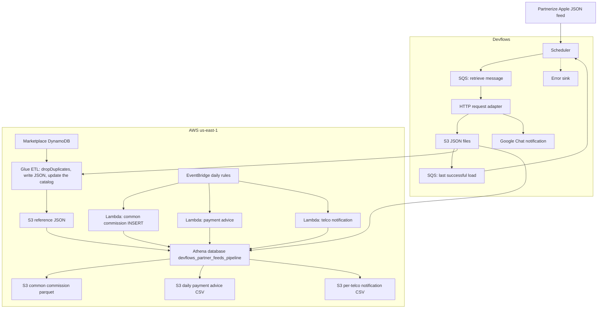
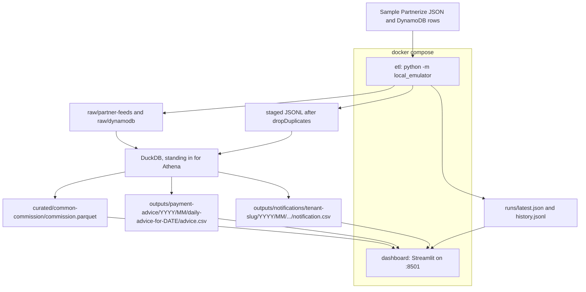

<p align="center"></p>

# AWS ETL Pipeline

Partnerize sends Apple subscription conversions as JSON. Four DynamoDB tables (tenant config, campaign, offer, activation link) say who that conversion belongs to. This repo is the Glue, Athena, and Lambda path that joins those inputs and writes three outputs: a common commission table, a daily payment-advice file, and one daily notification file per telco.

There was nowhere to look at those rows. There is now. `docker compose up --build` loads a fictional sample through a local stand-in for S3, Glue, and Athena, then opens a Streamlit desk on port 8501.

The original drawing is still in [`images/architecture.jpg`](images/architecture.jpg). The Devflows canvas that pulls the JSON is in [`images/devflows.jpg`](images/devflows.jpg). The diagrams below are the same system in a form you can diff.

---

## What the pipeline does, step by step

1. **Devflows pulls the feed.** A scheduler wakes up, reads an SQS message, and calls the Partnerize HTTP API. The JSON response lands in S3. A Google Chat node reports success. A second SQS queue stores the last successful load time. An error sink sits beside that flow for failures. The canvas nodes are `scheduler-v2`, `sqs`, `request-http`, `google-chat`, `s3`, and `error-sink`.

2. **Glue refreshes the reference tables.** Four Glue jobs (one script each under `glue-scripts/`) read a DynamoDB table from the Glue catalog, call `dropDuplicates()` on the whole row, and write JSON to S3. Those tables are the tenant config, the campaign, the offer, and the activation link. The catalog names in the scripts are redacted (`xxxx`). The names used by the SQL in this repo are `config_refreshed`, `campaign_refreshed`, `offer_refreshed`, and `activationlink_refreshed` in database `devflows_partner_feeds_pipeline`.

3. **A publisher reference ties a conversion to those tables.** Each conversion carries `publisher_reference` shaped like `tenantId.campaignId.linkId`. The link id matches an activation link, the activation link points at an offer, the tenant id matches config, and the campaign id matches a campaign. Rows that do not match, and references with no `.`, are dropped. One conversion with two items becomes two output rows. Publisher commission stays on the conversion, so it is repeated on each item row.

4. **Athena builds the common commission table.** `lambda-functions/common-commission.py` runs an `INSERT` on a daily EventBridge schedule. The window is `date_add('day', -24, now())`: uploads from the last 24 **days**, not 24 hours. The UNLOAD in `athena-queries/queries.sql` is the statement that first created the parquet under `s3://totogi-marketplace-partner-feeds/common-commission-table/`. Parquet is the format that accepts those inserts.

5. **Payment advice is a 24-hour slice.** `lambda-functions/payment-advice.py` runs `SELECT *` from the commission table where `loadtime` is newer than `date_add('hour', -24, now())`, and writes a CSV to a dated S3 prefix: `{year}/{month}/daily-advice-for-{date}/`.

6. **Telco notification is the same window, split by tenant.** `lambda-functions/telco-notification.py` lists distinct tenant names, then writes one CSV per tenant with supplier, tenant, campaign, offer, country, currency, subscriber, and subscription date. The production prefix lowercases the tenant name and splices it into the bucket.

7. **Nothing in the original repo reads those files back.** QuickSight was called out as a later phase. The desk in this repo is that read path, running locally against the sample lake.

The comparison in both Lambda windows is strict (`>`). An upload that lands exactly on the cutoff is excluded.

---

## AWS architecture



Services in play: DynamoDB, S3, Glue Data Catalog, Glue ETL, Athena, Lambda, EventBridge, SQS, and IAM. Devflows is the tool that stitches the HTTP pull to S3. The Glue scripts were generated by Glue Studio.

---

## Repository map

| Path | What it is |
| --- | --- |
| `glue-scripts/` | Four Glue Studio exports. Each reads one DynamoDB table, drops duplicate rows, writes JSON. |
| `lambda-functions/` | The three scheduled Athena callers: commission, payment advice, telco notification. |
| `athena-queries/queries.sql` | The UNLOAD that created the parquet, and a feed-only SELECT used while the JSON was being crawled. |
| `local_emulator/` | Sample data, the Glue dedupe step, and the DuckDB port of the Athena SQL. |
| `dashboard/` | The Streamlit desk. |
| `docker-compose.yml` | Runs the emulator, then serves the desk. |
| `scripts/verify_local_stack.py` | Checks the sample row counts and, if you pass it, the desk health URL. |
| `PRODUCTIONIZING.md` | What has to change before this is a real deployment. |

Column names in the local lake are snake_case so the desk and the tests do not depend on Athena's case folding. The mapping back to the SQL aliases:

| Athena alias | Local column |
| --- | --- |
| Supplier | `supplier` |
| TenantID | `tenant_id` |
| TenantName | `tenant_name` |
| CampaignID | `campaign_id` |
| CampaignName | `campaign_name` |
| OfferID | `offer_id` |
| OfferName | `offer_name` |
| Country | `country` |
| Currency | `currency` |
| SubscriberID | `subscriber_id` |
| SubscriptionDate | `subscription_date` |
| item_value | `item_value` |
| conversion_value | `conversion_value` |
| PublisherCommission | `publisher_commission` |
| ConversionID | `conversion_id` |
| LinkID | `link_id` |
| LoadTime | `load_time` |

The telco file keeps supplier, tenant name, campaign name, offer name, country, currency, subscriber id, and subscription date.

---

## Local emulation

Glue and Athena are not something you boot on a laptop without a lot of Spark. The joins in this project are SQL, and the Glue jobs are "read a table, drop duplicate rows, write JSON". So the local stack does this:

* **S3** is a directory, `.local-lake/`, bind-mounted into the containers at `/data/lake`.
* **The Partnerize pull and the DynamoDB tables** are a generated sample. Tenant names (Northwave Mobile, Cedarlink, HarborTel) are fictional. Timestamps are computed from the run's clock, so the 24-hour and 24-day windows still line up tomorrow.
* **Glue** is `dropDuplicates()` in Python, writing newline-delimited JSON under `staged/`. The raw exports, duplicates included, stay under `raw/dynamodb/` so you can see what was removed.
* **Athena** is DuckDB. `local_emulator/sql.py` is the port of the Lambda SQL: `split_part` for Presto's 1-based `split()[n]`, the same inner joins, and the same `REPLACE(upload-time, 'T', ' ')` cast. `upload-time` is read as text so DuckDB does not skip that cast by inferring a timestamp.
* **The desk** is Streamlit, reading the parquet, the CSVs, and `runs/latest.json`.

One difference is deliberate. The production commission Lambda `INSERT`s a rolling 24-day window, and a second day can repeat rows that are still inside that window. The local run deletes and rewrites the curated files, so `docker compose up` twice still yields 6 commission rows. `PRODUCTIONIZING.md` covers a partitioned overwrite for the real job.



A successful sample run writes:

* **6** common-commission rows (5 conversions; `conv-recent-1` has two items)
* **4** payment-advice rows (the last 24 hours only)
* notification files for **Northwave Mobile** (3 rows), **HarborTel** (1 row), and **Cedarlink** (header only, because its upload is 3 days old)

Also in the feed, and excluded on purpose: an unknown link id, a publisher reference with no dots, a missing campaign, a blank `upload-time`, an upload exactly 24 days old, and an upload 30 days old. An upload exactly 24 hours old stays in commission and drops out of advice and the telco files. Config, campaign, and activation link each contain one exact duplicate; the staged tables do not.

---

## Demo

A one-minute screen recording of this local stack is on the pull request that added the desk. It is not in the git tree. The clip shows, in order:

1. `docker compose run --rm --no-deps etl` printing `succeeded`, 6 commission rows, 4 payment-advice rows, and exit 0.
2. Run status on the desk, with those same counts and a green succeeded banner.
3. Common commission: the tenant chart, the country chart, and the item table.
4. Daily payment advice, including the `daily-advice-for-…` CSV path and 4 rows.
5. Telco notifications: Northwave Mobile's file (3 rows), then Cedarlink, whose file is header-only because that upload is 3 days old.

Play the same sequence yourself after the desk is up:

```bash
docker compose up --build -d
docker compose run --rm --no-deps etl
```

Open http://localhost:8501. In the sidebar, open Run status, then Commissions, then Payment advice, then Telco notifications. On the telco page, choose Northwave Mobile, then Cedarlink.

---

## Run it with Docker

You need Docker Engine and the Compose plugin. From the repo root:

```bash
docker compose up --build
```

That does three things, in order:

1. Builds one Python 3.12 image with DuckDB, pandas, pyarrow, and Streamlit.
2. Runs `python -m local_emulator`. The container writes the lake, prints a JSON summary, and exits 0.
3. Starts Streamlit only after that exit is successful. The desk listens on [http://localhost:8501](http://localhost:8501).

The entrypoint chowns the lake to `LOCAL_UID`/`LOCAL_GID` (default `1000`) and then drops root, so the files in `.local-lake/` belong to your user. Override those variables if your uid is not 1000.

Leave the terminal attached, or add `-d` to run in the background. Stop the desk with Ctrl-C, or:

```bash
docker compose down
```

`down` removes the containers and keeps `.local-lake/`. That directory is gitignored. Delete it when you want a clean slate.

Run the load again without rebuilding:

```bash
docker compose up --force-recreate
```

Or reload the lake while the desk is already up:

```bash
docker compose run --rm etl
```

Then use **Reload lake** in the sidebar. The desk reads the files on each interaction, so it does not need a restart to see a new run.

Check the result without clicking:

```bash
python scripts/verify_local_stack.py --health-url http://127.0.0.1:8501/_stcore/health
```

That script expects the sample counts above, a `succeeded` manifest, every quality check passing, and the body `ok` from Streamlit's `/_stcore/health`.

### What you can click through

* **Run status.** Commission rows, advice rows, tenants, duplicates removed, the four steps, and the quality checks. A green "Latest run succeeded" means the gates passed.
* **Commissions.** Filter by tenant, campaign, country, currency, or a piece of a conversion id. Try `harbor`. The commission total counts each conversion once, because the item grain repeats that amount. Clearing a multiselect matches nothing, which is what an empty selection should do.
* **Payment advice.** The dated CSV path and the 24-hour rows. Cedarlink is not here.
* **Telco notifications.** Pick Cedarlink. The file exists and the page says it is header-only.
* **Reference data.** The staged DynamoDB tables and the raw feed files, including the one with a blank upload time.

The page background is `#14110e` and the text is `#f4efe6`, with copper `#e08a3c` for the charts and metric rules, so the type stays readable on the dark desk.

---

## Run it without Docker

Same lake, same desk, on the host. Use Python 3.12.

```bash
python3 -m venv .venv
source .venv/bin/activate
pip install -r requirements-dev.txt
python -m local_emulator
streamlit run dashboard/app.py
```

`python -m local_emulator` writes `.local-lake/` unless `LAKE_DIR` points somewhere else. If a previous Docker run left that directory owned by root, either delete it or `sudo chown -R "$USER" .local-lake` before the host command. Current images chown it for you on the next `docker compose up`.

The tests use a temporary directory and a fixed clock (`2026-10-29 16:00:00`), so they do not touch `.local-lake/`:

```bash
pytest
```

---

## How a local run is put together

This is the path `run_pipeline` walks. The AWS scripts it stands in for are named in the module docstring of `local_emulator/pipeline.py`.

1. Clear `raw/`, `staged/`, `curated/`, and `outputs/`. Keep `runs/history.jsonl`.
2. Build the sample from the business clock and write one JSON document per feed.
3. Write the reference rows, duplicates included, to `raw/dynamodb/`, then write the deduped rows to `staged/<table>/<table>.jsonl`.
4. Open an in-memory DuckDB database, store the two cutoffs, and run the commission `SELECT`. Copy the result to parquet.
5. Run the payment-advice `SELECT *` and write the dated CSV.
6. `SELECT DISTINCT tenant_name`, then run the notification statement once per tenant with a bound parameter. The production Lambda interpolates the tenant name into the SQL string. The local run does not.
7. Evaluate the quality checks (rows exist, required fields are filled, advice ids come from commission, both windows hold, notification tenants match commission, reference tables are non-empty).
8. Write `runs/latest.json` and append one line to `runs/history.jsonl`. A failed check exits non-zero, which stops Compose from starting the desk.

Blank upload times are excluded and do not abort the scan. The production `CAST` has no such guard. That is called out in `PRODUCTIONIZING.md`.

---

## Sample clock, if you want to replay the test date

The CLI uses UTC now. The tests pass `2026-10-29 16:00:00`. To build that same lake on the host, from a Python shell:

```python
from datetime import datetime
from pathlib import Path
from local_emulator.pipeline import run_pipeline

run_pipeline(Path(".local-lake"), now=datetime(2026, 10, 29, 16, 0, 0))
```

Advice then lands at `.local-lake/outputs/payment-advice/2026/10/daily-advice-for-2026-10-29/advice.csv`.

---

Next steps for a real AWS deployment (infrastructure as code, CI, alarms, data-quality gates, and a desk that queries Athena instead of a laptop directory) are in [`PRODUCTIONIZING.md`](PRODUCTIONIZING.md).
